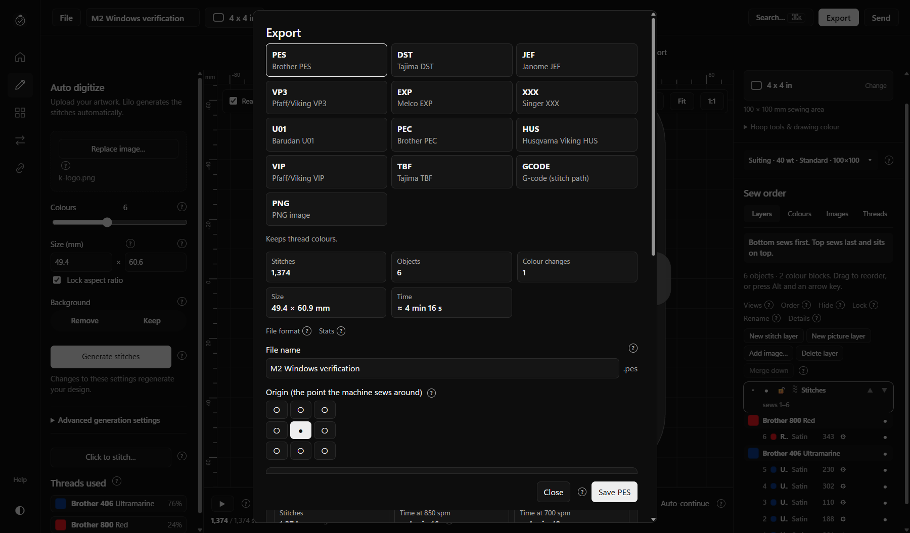
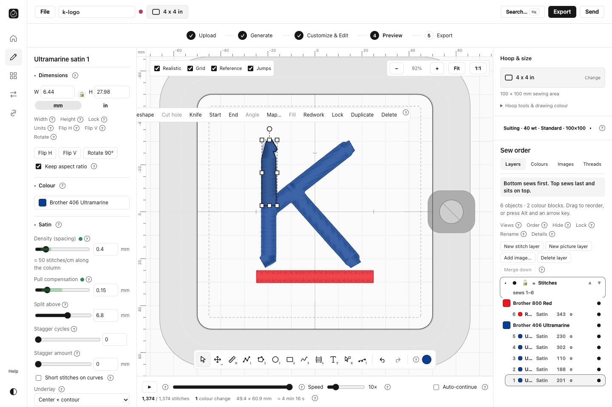

# M2 — Embroidery Studio desktop packages

**M2 is complete for private review. M3 has not started.** The Windows application installs separately from Lilo. Windows and macOS packages are available below. The remaining distribution limits are signing, notarization and final branding.

19 October 2026. Working name: **Embroidery Studio**, version **1.4.0**. Approved M1: `6334c8b`. Packaged application source: `6234b89c6061474bea16abe578a7b8f0f509aa2d`; subsequent changes concern tests, delivery tooling and reports.

**The original `Kadwood/lilo` repository was used only as a reference and was not changed.** GitHub confirms read-only access; all recorded pushes went to the private working repository. Its local push URL is now disabled as an extra safeguard. See [repository isolation evidence](reports/M2/evidence/repository-isolation.json).

## Open the application

The tested Windows copy is already installed at **[Embroidery Studio](<C:/Users/mazin/Applications/Embroidery Studio/embroidery-studio.exe>)**, with its own Start menu entry. Your original Lilo executable and existing file defaults were verified unchanged. New projects use **Documents/Embroidery Studio**. Open existing `.lilo` projects from wherever you keep them.

## Finished packages

| Package | Size | Exact bytes |
|---|---:|---:|
| [Windows installer (x64)](<dist/M2/Embroidery Studio_1.4.0_x64-setup.exe>) | 230.14 MiB | 241,316,900 |
| [macOS disk image (Apple Silicon + Intel)](<dist/M2/Embroidery Studio_1.4.0_universal.dmg>) | 51.31 MiB | 53,798,509 |
| [macOS application ZIP (alternative)](<dist/M2/Embroidery_Studio_1.4.0_universal.app.zip>) | 51.04 MiB | 53,515,689 |

Files are local and remain available after the temporary GitHub artifact expires. The [delivery instructions](dist/M2/READ_ME_FIRST.md), [checksums](dist/M2/SHA256SUMS.txt), licence, notices and a saved sample project are included in the [delivery folder](dist/M2).

The Windows installer includes the **offline WebView2 installer**, which accounts for most of its size. The installed folder contains the application, uninstaller, licence and notices; development dependencies, source maps and test evidence are excluded. macOS bundles were also checked for development files. Required fonts, WASM, thread data and runtime assets remain included.

## What changed

- Prepared a separate name, hoop-and-stitch icon, native/window/page titles, installer identity, shortcut and uninstall entry. Updated help and prompts, including inherited download and signing instructions.
- Set the application ID to `io.github.thomasttcryoo.embroiderystudio`, executable to `embroidery-studio`, local bridge port to **17842** and protocol to `embroidery-studio://`. Application data and projects use separate locations.
- Windows adds **Open With** entries while preserving all 12 existing project/stitch extension defaults. macOS declares alternate handlers for compatible files.
- Disabled automatic updates at the native and frontend levels and removed update endpoints. This application cannot check or install Lilo releases through its updater.
- Preserved the embroidery engine, algorithms, export formats and approved M1 layout. Editing, project and platform code changed only through literal branding-word substitutions; the source guard checks this. Required upstream licence and credit notices remain.

## Tests and results

| Check | Result |
|---|---|
| Windows installer build/install and final normal launch | Passed; installed binary matches the packaged build, accounting for Tauri's three-byte NSIS bundle marker |
| Installed Windows functional checks | **10 passed**, including native dialogs, conversion, editing/undo, hoop, simulation, saving, reopening and final release launch |
| Windows native Rust | **92 library + 18 API integration tests passed** |
| macOS universal app and DMG | Built, verified, installed from DMG and natively launched on the Mac runner |
| macOS native Rust | **96 passed** |
| Editor regression | **650 unique tests passed across 58 files in the final recorded runs**; 608 unaffected full-run tests plus 42 tests in the two final rerun files |
| Script checks | **32 passed** |
| Production workflow acceptance | **9 passed on Windows + 9 passed on macOS**, with external HTTP(S) blocked |
| All exports and project round-trip | **13 exports**, **11 machine-format readbacks**, PNG/G-code checks and `.lilo` save/reopen passed on both OS browser runs |
| TypeScript, guide, versions and source protection | Passed |
| Embroidery engine | Unchanged; approved M1 baseline was **899 passed, 22 upstream skips**; that suite was not rerun in M2 |

The actual native Windows application converted the public PNG sample to **1,374 stitches**, one colour change and **49.4 × 60.9 mm**. Editing changed pull compensation from **0.15 to 0.33 mm**, and Undo restored it. A **100 × 100 mm** hoop was selected while editing. Saving and reopening preserved all six editable objects. The native PES export was **4,072 bytes** with a valid PES header; simulation completed at 50×.

Production acceptance on both operating systems uses the real engine, real file inputs/downloads and blocked external HTTP(S), rather than mocked conversion results. All **13 exports** were written: PES, DST, JEF, VP3, EXP, XXX, U01, HUS, PEC, VIP, TBF, G-code and PNG. All 11 readable machine formats reopened with 1,374 stitches; G-code and PNG were checked separately. The editable `.lilo` project also saved and reopened successfully.

Evidence: [Windows native checks](reports/M2/evidence/windows-native/results.json), [installation isolation](reports/M2/evidence/windows-isolation.json), [Windows production checks](reports/M2/evidence/acceptance/results.json), [macOS native checks](reports/M2/evidence/macos/native-macos-results.json), [macOS production checks](reports/M2/evidence/macos/acceptance/results.json), and [verification manifest](reports/M2/evidence/verification.json).

## Real application screenshots

Actual installed Windows application, final package:

Native Windows export screen from the M2 functional verification:

Actual macOS application launched from the DMG on the runner, with the sample loaded behind its first-run welcome:

The detailed macOS editing/export workflow was tested separately in Chromium on that same macOS runner:

## macOS build and testing scope

The final [private GitHub Actions run](https://github.com/thomastt-cryoo/embroidery-aapp-/actions/runs/39307805583) built the universal application and DMG, verified the disk image, copied the application from it and launched the native app on **macOS 14.8.9, Apple Silicon**. Both **arm64 and x86_64** are present in the binary. The native health check, project rendering, app identity, package contents and ad-hoc signature verification passed.

This is actual macOS execution, beyond a successful compile. Detailed image conversion, editing, hoop selection, simulation, project round-trip and all exports passed in Chromium on the same runner. Native macOS editing and file-dialog journeys were not fully automated. Intel execution, a consumer Mac installation through Gatekeeper, and physical embroidery-machine sewing/Wi-Fi transfer remain untested.

Measured macOS runner time was **18 minutes 22 seconds** in total: 10:29 for the initial successful job, 1:31 for the cancelled job and **6:22 for the final successful job**. This stays within your stated 200-minute ceiling. The available billing API did not expose the remaining free allowance, so no account-balance claim is made. No paid larger runner or billing setting was enabled. See [runner evidence](reports/M2/evidence/actions-final.json).

No public releases, tags, Pages deployment or public artifacts were created. Source and build artifacts were pushed only to the user-approved **private** repository. Artifacts have two-day retention; verified local copies are retained here.

## Issues resolved and remaining limits

The inherited website workflow ran on the first private push and failed because Cloudflare credentials were absent; its logs show no deployment. It is now disabled, including manual execution. An initial macOS workflow-context error was fixed before a runner job started. One superseded macOS run was cancelled to avoid unnecessary usage.

The Windows installer hook initially wrote incorrect quotation marks in its Open With command. It was corrected, rebuilt, installed and verified. A native unit test assumed Unix file URLs; its fixture now uses the current operating system's paths. The editor run also exposed a stale branding assertion and test timeouts under concurrent builds; the two affected files were corrected or rerun and all 42 tests passed. The hoop warning fixture uses the same-sized outline to avoid unnecessary fill planning. Detailed evidence and the count of 650 unique passing tests are recorded in the [regression summary](reports/M2/evidence/regression-summary.json).

**The Windows packages are unsigned. The Mac application is ad-hoc signed, without an Apple Developer ID or notarization.** They are private review packages. Trusted signing and notarization are still required for normal public distribution, and the final product name/icon await your decision. No signing credentials were available or invented.

## Checkpoints and handoff

1. [Identity, separation and private build plan](reports/M2/01-identity-and-build-plan.md)
2. [Packages and compatibility regression checks](reports/M2/02-packages-and-regression.md)
3. [Installed Windows and actual macOS verification](reports/M2/03-desktop-verification.md)

[Build and verification handoff](reports/M2/DEVELOPMENT.md) records reproducible commands and the protected code boundaries. **Work stops at M2 for your approval.**
