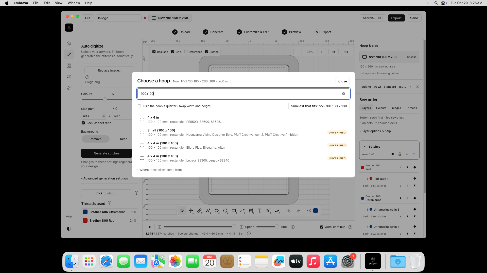

# M2 — Embrova final customer packages

20 October 2026. The requested Embrova name, complete supplied logo, small rounded sidebar logo, Windows taskbar icon and Mac Dock icon are included in these final packages. Installation/launch checks passed for the final Windows ZIP; all eight installed-app functional checks passed for the final Mac ZIP.

## Final downloads

Use these files to replace earlier copies. Their folder contains exactly one ZIP per platform.

| Platform | Complete customer ZIP | Exact ZIP bytes | Installer bytes |
|---|---|---:|---:|
| Windows x64 | [Embrova-Windows.zip](<C:/Users/mazin/Downloads/embroidry app/dist/Embrova-Customer-Release-20261020/Embrova-Windows.zip>) | **17,042,356** | 17,035,951 |
| macOS, Intel and Apple silicon | [Embrova-macOS.zip](<C:/Users/mazin/Downloads/embroidry app/dist/Embrova-Customer-Release-20261020/Embrova-macOS.zip>) | **20,172,883** | 20,156,946 |

Each ZIP contains one complete installer, START HERE.txt, LICENSE.txt and NOTICE.txt. Customers extract and install normally. No split parts, reconstruction scripts, development tools or test evidence are in these downloads.

The owner confirmed that Etsy accepted the earlier **20,207,345-byte** Mac ZIP and instructed us to stop size tuning. This final Mac ZIP is **34,462 bytes smaller** and includes the rounded Dock icon. It exceeds the original strict decimal 20,000,000-byte target by 172,883 bytes; the owner explicitly accepted that exception. This newly changed ZIP has not been uploaded to Etsy by the agent. Final packaging used the same compression method once, without further tuning.

## Completed and preserved

- Product names, native titles/menus, installer metadata, shortcuts and current help use **Embrova**. The full supplied flower and wordmark are fitted without cropping. Sidebar logos are 32 x 32 pixels with rounded corners.
- Windows executable, taskbar/window, tray and installer icons have transparent rounded corners. A build-cache issue retaining old icon resources was fixed. All six ICO images and the rounded runtime image were verified in the actual installer payload; its installed executable checksum matched exactly.
- The Mac Dock icon is now rounded. Only its native icon and ad-hoc signature seal were renewed. Both architectures' executable code and embedded runtime asset bytes were verified unchanged, excluding only signature metadata. The app was not recompiled for this icon refresh.
- Tauri 2, the embroidery engine, M1 interface, prior Stitches/sidebar corrections, colours/layers/shapes/lettering/stitch tools, hoop selection, thread selection, simulation, project format and export formats are retained.
- All 459 frontend runtime assets remain, including fonts, WebAssembly and thread data. PNG storage optimization preserves pixels and colour profiles. Native icon PNG encoding is lossless.
- Windows uses the standard conditional WebView2 bootstrapper. No other application components are downloaded. Processing works offline after installation.
- The original Lilo repository and installed app were not modified. Embrova retains its independent identity and disabled original update channel. Its existing internal identifier preserves settings compatibility. New projects default to Documents/Embrova; projects in the former temporary-name folder remain accessible without moving or deleting them.

## Final tests

| Check | Result |
|---|---|
| Windows actual ZIP extraction, installation and native launch | Pass |
| Windows installed product/window name | Embrova |
| Windows installed executable versus actual installer payload checksum | Exact match; rounded icons verified |
| Mac actual ZIP installation and all installed files/permissions versus sealed package | Pass |
| Mac universal ARM/Intel binary and strict signature integrity | Pass; ad-hoc signature |
| Native Mac image picker/conversion | Pass; 1,374 stitches |
| Native Mac stitch rendering with reference image hidden | Pass |
| Native Mac simulation | Pass; zero to completion at 50x |
| Native Mac hoop selection | Pass; 100 x 100 mm |
| Native Mac stitch editing | Pass; pull compensation 0.15 to 0.35, restored to 0.15 |
| Native Mac editable project save/reopen | Pass; six objects, reopened with 1,374 stitches |
| Native Mac PES export through the actual Save dialog | Pass; 4,072 bytes, valid PES header |

Final native Mac execution was on **Intel macOS 15.7.9**. Both architectures are included and signature/code-integrity checked. ARM execution passed on the earlier pre-branding package; it was not repeated for this final icon refresh. Earlier M2 coverage of other export formats remains historical; not every format or machine was individually retested here.

Additional checks passed: 34 layout/navigation checks with Windows/Mac user agents, themes and window sizes; 130 relevant frontend tests; 16 native project tests; TypeScript/guide checks; eight package/report contract tests; three compression-recovery control tests; source, independent identity, offline and update-channel preservation checks. Browser layout tests are distinct from native Mac testing.

- [Final Windows installation run — passed](https://github.com/thomastt-cryoo/embroidery-aapp-/actions/runs/39392991337)
- [Final Mac icon refresh, installation and eight native checks — passed](https://github.com/thomastt-cryoo/embroidery-aapp-/actions/runs/39392239556)
- Windows evidence: reports/embrova-branding/windows-customer-install/windows-install-results.json and windows-rounded-icon-readback.json.
- Mac evidence: reports/embrova-branding/mac-customer-delivery/evidence, including size-gate.json, repackaging-source.json, native-branding-check.json and native-ui/summary.json.

An earlier Windows verification used the unbundled developer executable checksum; Tauri changes a three-byte installer-type marker during packaging. After extracting the finished installer and confirming all rounded icons again, the final check used the actual installer payload checksum and passed. No application change was needed for that test correction.

## Real screenshots

The real final Mac home screenshot shows the Embrova name, small rounded sidebar logo, aligned navigation and rounded Dock icon:

The [illustrated Mac app guide](reports/M3/02-macOS/embrova-final-20261020/MAC_APP_WALKTHROUGH.md) uses reviewed real screenshots. All 15 unedited 1920 x 1080 PNG originals, capture index, privacy review, sample project and PES outputs are retained separately in that folder. CI path-entry screenshots are internal evidence rather than customer instructions. No app was opened or installed on the owner's Windows desktop for this update.

## Scope and limitations

The requested branding, rounded native icons and final customer packages are complete. These are release builds. Windows remains unsigned; Mac uses ad-hoc signing without Developer ID/notarization. They are not commercially certificate-signed releases. Security-warning/Gatekeeper walkthrough work was left aside at the owner's explicit request. No warnings were fabricated, protections disabled, billing enabled or public Release/website published.

Historical reports are preserved in reports/M2/archive and reports/M3/archive; checkpoints remain in reports/embrova-branding. No further compression, feature work or new milestone is being started.

Windows ZIP SHA-256: 68f1cbd8f34790ccdf3781388d49f581e5496bc58eed8751c58953c9489dcfbd

Mac ZIP SHA-256: 94ef8b1f9798419adc96b7c1c202f99ca83ff936564136cc620fd26bac620e01
