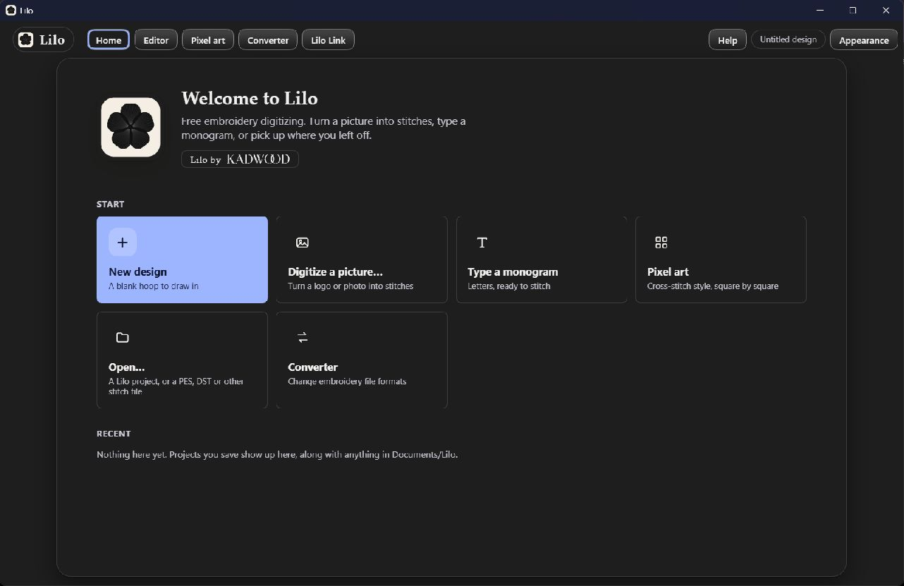
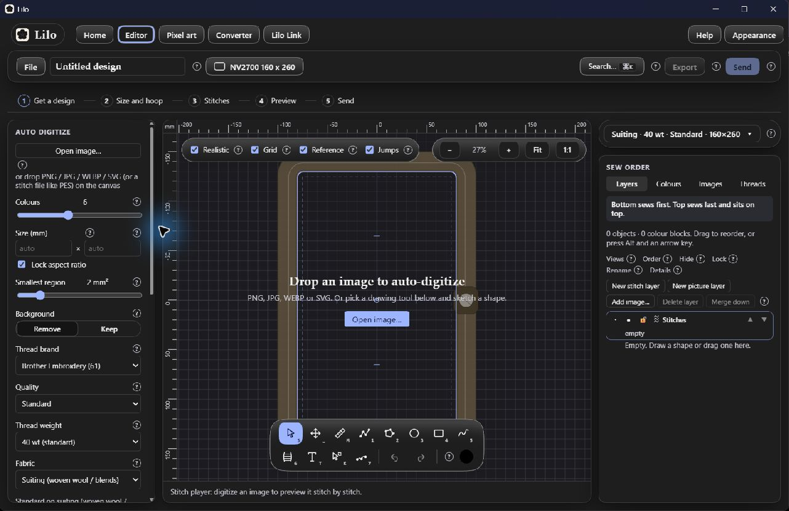

# M1 checkpoint 1 — Baseline and interface plan

Date: 19 October 2026. Repository: https://github.com/Kadwood/lilo. Working branch: `codex/m1-ui-redesign`.

## Completed

- Cloned the GitHub source into this development folder and installed its locked dependencies.
- Opened the existing Windows installation at `%LOCALAPPDATA%/Lilo/lilo.exe` and inspected Home and the editor. The existing installation and user projects have not been replaced.
- Verified the frontend builds and type-checks before UI changes. The full automated baseline and first native build are running; their raw logs are in `evidence/`.
- Audited the boundary: `engine/` owns conversion, geometry, stitching, thread matching and formats; `editor/src/state/` owns editing and undo; `editor/src/platform/` and `project/` own desktop I/O and projects. These implementations will stay unchanged.

## Findings and plan

The current screen uses glass effects, small controls and several nested bars. Generation is below many settings. Full hoop controls disappear when an object is selected. Home gives six starts similar emphasis.

The new interface will use solid white/black surfaces, quiet borders, consistent sans-serif type, a clear primary action, and restrained monochrome navigation. Real thread colours remain visible.

1. **Upload:** one prominent start on Home and a clear canvas drop area. Existing local import handles PNG, JPG, WEBP and SVG.
2. **Generate:** keep the existing automatic generation on import; expose a clear Generate action for reruns. Show basic colour, size and background options first; put specialist options in named expandable groups.
3. **Customize & Edit:** retain the contextual settings panel, complete drawing toolbar, lettering, thread catalogue, layers and sequence views.
4. **Preview:** keep the real stitch player, thread-change stops, view toggles and realistic rendering.
5. **Export:** make Export the primary final action and preserve all formats, save/open/history and machine sending.

Hoop & size will have a permanent editor inspector, including machine/brand search, custom hoops, rotation, fit assistance, margins, rulers, placement and calibration. Selection must not remove access to these tools.

## Baseline screenshots

## Tests and limitations

- Installed app launches; Home and blank editor render successfully.
- Locked dependency installation succeeded. Fonts are prepared by the upstream build script for offline use; it reports existing exclusions and unsupported font elements.
- Baseline frontend production build and type-check succeeded. Upstream build warnings concern WASM URL resolution, mixed static/dynamic imports and a large font chunk.
- Windows is available for native verification. A native macOS run requires a Mac and cannot be certified here.
- No embroidery machine is connected for a physical sew-out or Wi-Fi transfer.

## Next

Implement the solid visual system, navigation and new Home. Then integrate the workflow and persistent hoop inspector and run all applicable regression tests. Final test counts and baseline failures will be recorded in the final report.
