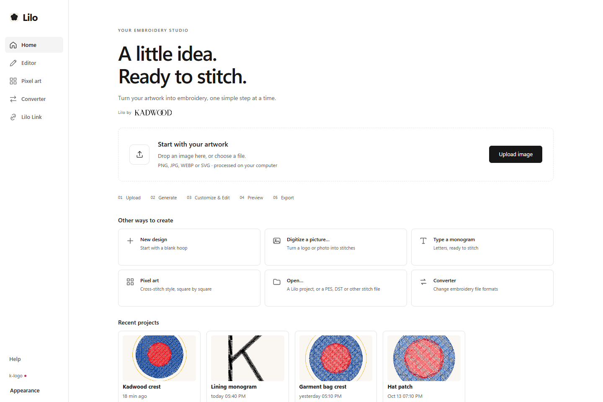
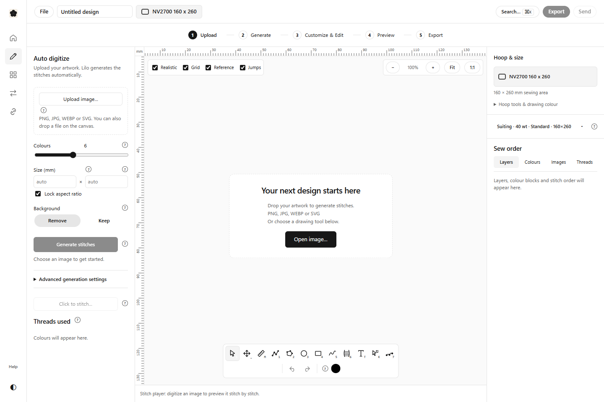

# M1 checkpoint 2 — Layout and visual system

Date: 19 October 2026.

## Completed

- Replaced the glass appearance with opaque white/light and black/dark surfaces, neutral borders, sans-serif typography and quiet monochrome actions. Thread colours are preserved.
- Added a navigation sidebar, with a compact version in the editor to leave more room for artwork.
- Redesigned Home around one prominent Upload image action, a five-step workflow, alternate creation tools and recent projects. Home now accepts dropped artwork as well as project/stitch files.
- Made Export the primary final action. Send and the existing File menu remain available.
- Added the permanent Hoop & size inspector and moved the complete hoop/drawing-colour controls into its expandable section.

## Verification

- Viewed the running React application in Chromium and corrected inherited glass shadows and the empty-canvas overlay position.
- Verified that Home, editor navigation, blank design and the new inspector render. The source uses the original providers and store actions.
- Screenshots below are from the real running frontend using the repository's development platform (sample recent projects and in-memory file dialogs). These are application renders, not design mockups. Native Windows screenshots will accompany the final checkpoint.

## Problems and limitations

- The initial baseline browser run overlapped active UI edits and is not a valid regression result; it was stopped. The final journey suite will run against stable files.
- First-time font preparation and native Rust dependency downloads are substantial. They are build-time tasks; the app keeps its offline engine and bundled assets.
- Full regression results are pending and will be recorded in checkpoint 4.

## Next

Finish workflow actions, group advanced generation controls, update help text and exercise conversion, editing, hoop changes, preview and every export format.
