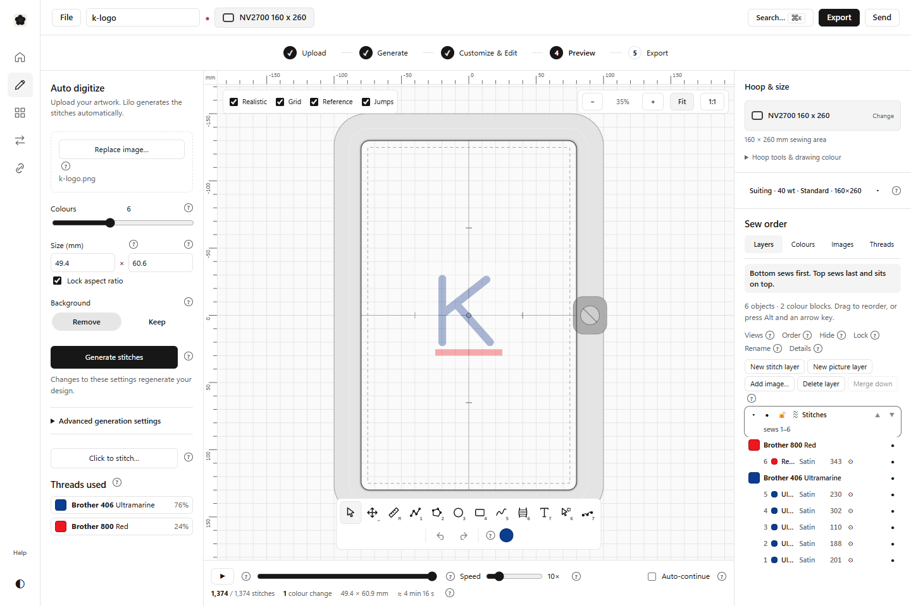
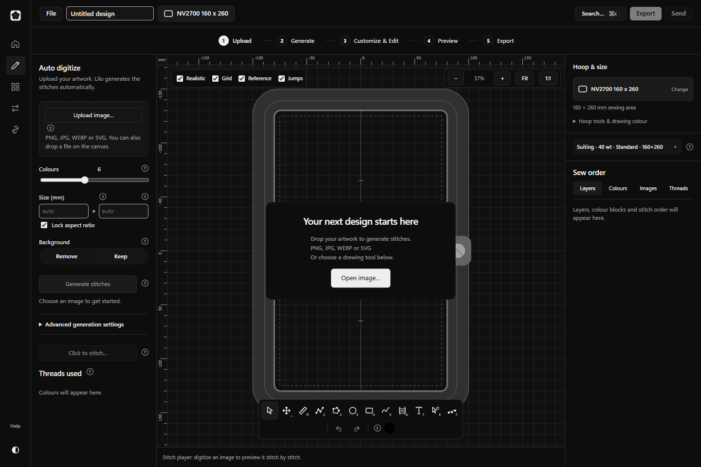

# M1 checkpoint 3 — Workflow and editing integration

Date: 19 October 2026.

## Completed

- Implemented **Upload → Generate → Customize & Edit → Preview → Export** using the existing editor actions.
- Preserved automatic conversion after upload and live regeneration when its settings change. Added a clearly named **Generate stitches** action before the advanced options.
- Grouped region cleanup, catalogue, fabric, weight, quality and shelf matching under **Advanced generation settings**. Every previous control remains present.
- Preserved the full drawing toolbar, contextual stitch/shape settings, lettering, layers, colours, images, My Threads, realistic rendering and stitch simulation.
- Kept hoop selection and dimensions visible while editing a shape or lettering. Full hoop tools remain in the workspace inspector.
- Updated the introductory guide and workflow tips. Fixed popover positioning so sidebar menus flip and stay within the viewport.
- Added a separate preview configuration with its own application identifier, so testing the native build can use its own app-data folder.

## Tests and results

- Direct PNG conversion in the real engine: **1,374 stitches, 1 colour change, 49.4 × 60.9 mm**. Both thread colours appear in the palette and layer list.
- Light and dark editor views checked in Chromium. Corrected inherited shadows, empty-canvas positioning, disabled action contrast and the bottom-sidebar appearance menu.
- Added tests for persistent hoop access and retained advanced controls, and adapted the existing browser journeys to the new control labels and disclosure groups.
- Added a repeatable acceptance script: `node scripts/m1-ui-check.mjs` (with `pnpm dev` running). It checks responsive layouts, selected-shape hoop access, simulation and every export format; writes screenshots, output files and JSON results.

## Problems and limitations

- Vitest's default fork runner timed out before starting a small colour test. Running that same test with `--pool=threads` passed all four assertions. Full suites now use that runner; no engine code was altered to work around the issue.
- The initial guide check found stale generated reference pages. Regenerating these through the existing guide script is part of final verification.
- Native build, complete unit suites and browser journeys are still running. Their final outcomes belong in checkpoint 4.

## Next

Fix any regression failures, verify every export by reading it back, complete the native Windows preview and compile the final report with actual desktop screenshots and explicit platform limitations.
