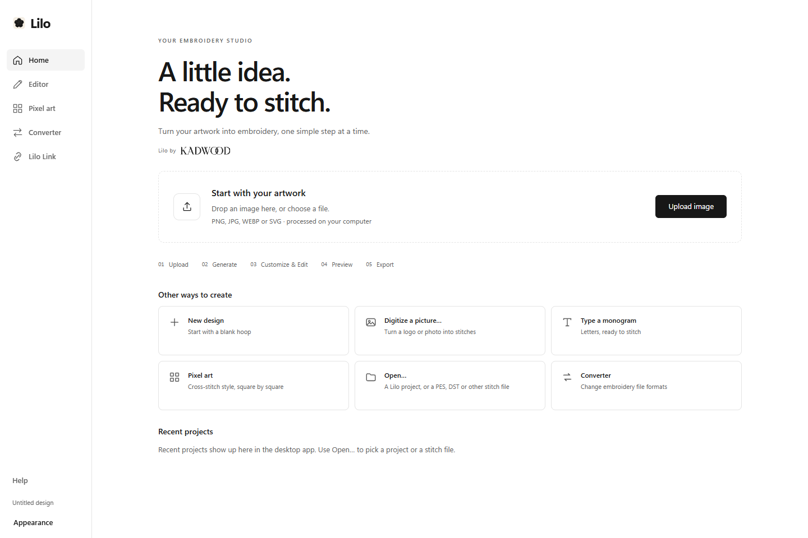
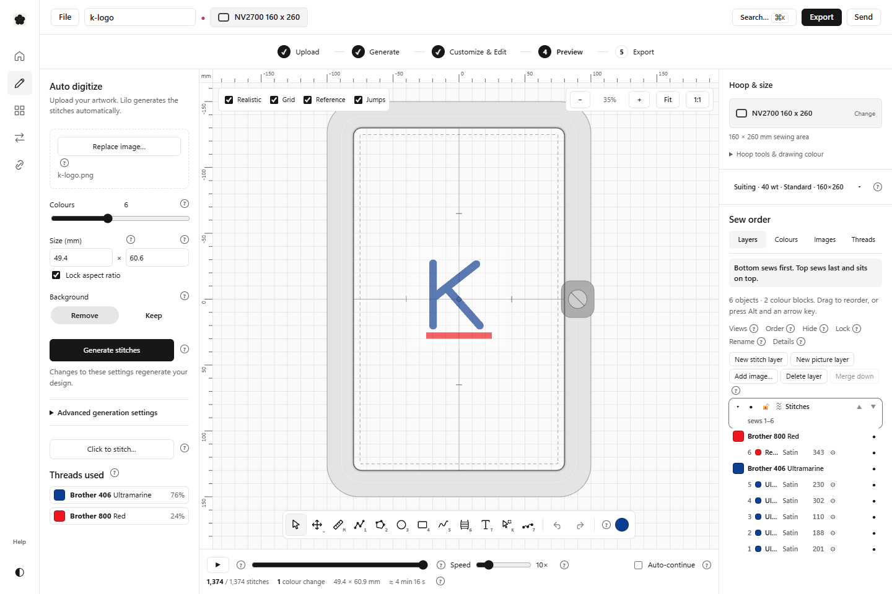
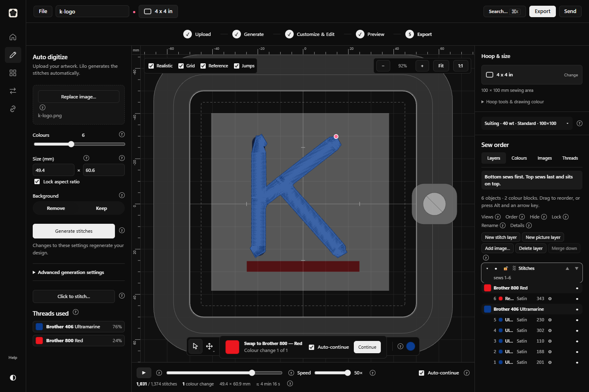
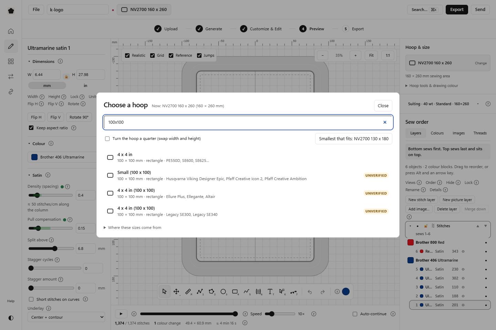
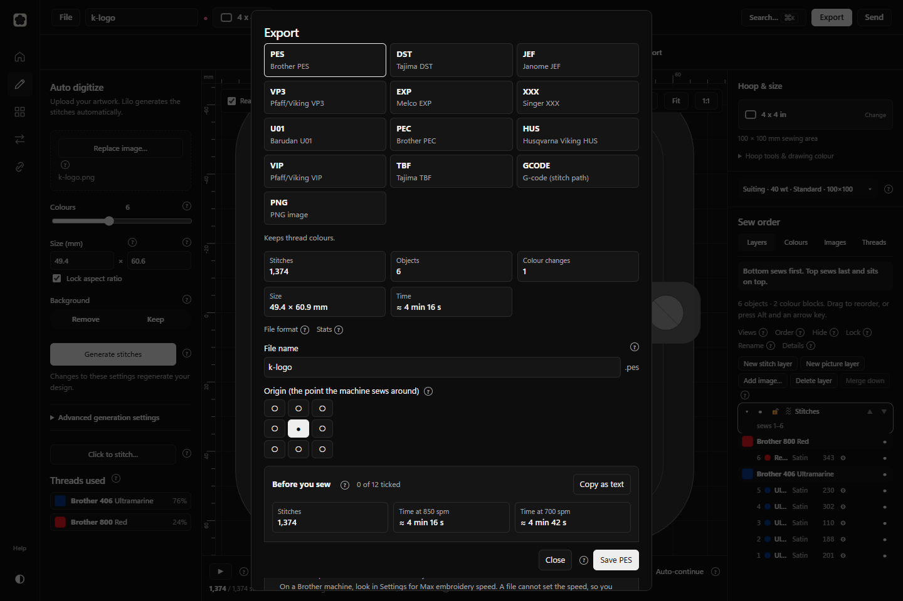
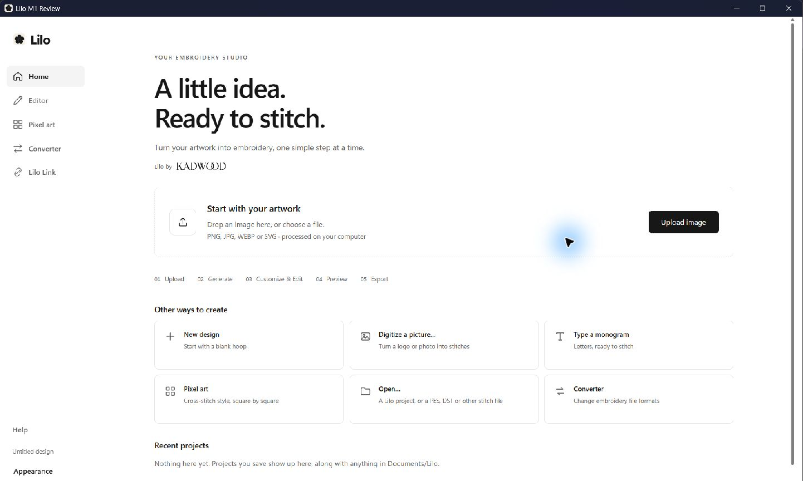
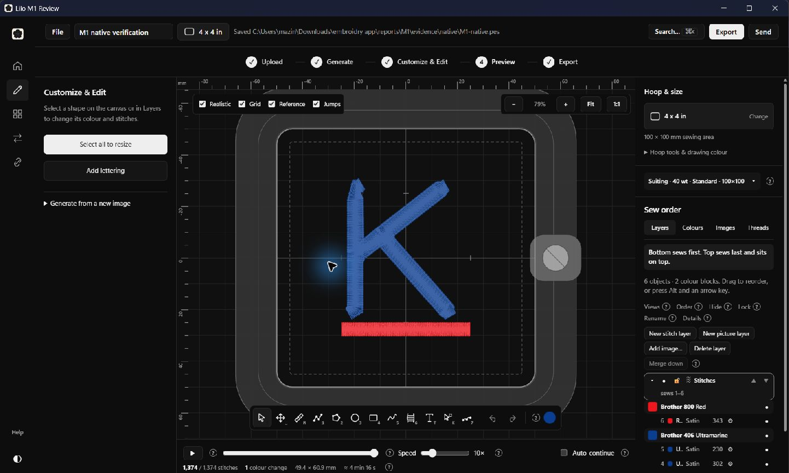
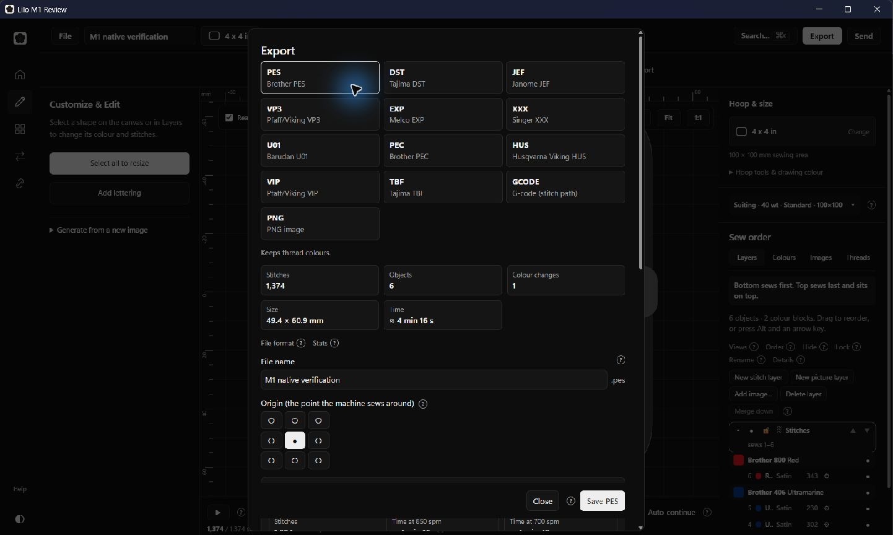

# M1 — Final review

**M1 is complete and ready for your review.** Open `M1 Preview/Lilo M1 Review.exe` in the project folder. No later milestone has been started.

19 October 2026. Lilo interface redesign, based on the installed **v1.4.0** and the matching GitHub source at `c82a9d7ddae21e73048ccd4163b2ad22c4829f8c`.

## What changed

Lilo now has a solid white or black interface, monochrome navigation, consistent type, and one prominent **Upload image** action. The editor follows **Upload → Generate → Customize & Edit → Preview → Export**. Uploading starts the existing conversion automatically. Basic colour, size and background controls come first; specialist generation settings are in an expandable group.

**Hoop & size stays visible while editing.** It shows the selected hoop and sewing area, with search, custom sizes, fitting, rotation, rulers, margins and calibration available through the existing tools. Saved and drawn designs open with editing actions rather than an empty upload panel.

All original tools remain: drawing and reshaping, stitch settings and patterns, lettering and custom fonts, colour and thread catalogues, My Threads, layers and sew order, images, realistic rendering, simulation, projects and history, converter, pixel art, machine sending, and export formats. Export is the primary final action, and its Save button stays visible in smaller windows.

The local working copy is on branch `codex/m1-ui-redesign`. The installed application has not been replaced. The review build uses Tauri 2 and a separate application profile; the standard Windows/macOS configuration remains intact.

## The embroidery engine is unchanged

A comparison against the matching upstream version confirms **no changes** in:

- `engine/` — conversion, geometry, stitching, thread matching, file readers and writers.
- `editor/src/state/` — editing actions, state and undo/redo.
- `editor/src/platform/` and `editor/src/project/` — file I/O and project management.
- `app/src-tauri/src/` — native Rust implementation, including the machine bridge.

The canvas changes concern viewport fitting and resizing only. Windows script fixes handle line endings and file paths. Test updates follow renamed controls, expandable tool groups and asynchronous stitch planning.

## Screenshots

These are captures of the running application with the repository's public test artwork, not visual mockups. The native Windows captures are included below after the desktop verification results.

## Test results

| Check | Result |
|---|---|
| Embroidery engine suite | **899 passed**, 22 upstream skips; no engine changes |
| Editor suite | **648 passed** across 57 files |
| Build/guide/version script tests | **32 passed** |
| Production frontend | Type-check and production build passed |
| Offline workflow | **9 acceptance checks passed** with external HTTP(S) blocked; no external requests occurred |
| Window sizes | 960 × 600, 1280 × 800 and 1440 × 960: no horizontal overflow; canvas and appearance menu usable |
| Image conversion | PNG → **1,374 stitches**, 1 colour change, **49.4 × 60.9 mm** |
| Hoop selection during editing | Changed to **100 × 100 mm** with a generated object selected |
| Simulation | Completed at 50× with automatic colour-change continuation |
| Exports | All **13 formats** written successfully; details below |
| Project round-trip | Saved and reopened `.lilo`; stitch count and dimensions preserved |
| Native Windows build | Release build passed; **12 native checks passed**, including Windows image import, PES Save As and reopen, project saving, editing/undo and simulation |
| Existing browser journeys | **11 passed** across the final recorded runs; optional performance benchmark skipped |
| Final source checks | TypeScript checks (including browser tests), guide generation check, protected-source comparison and whitespace checks passed |

The production acceptance run uses real browser file inputs/downloads and the real engine. It does not use the development platform's mock storage. See [structured acceptance results](evidence/acceptance/results.json), the actual [sample project](evidence/acceptance/exports/k-logo.lilo), and [reproduction instructions](DEVELOPMENT.md).

### Windows desktop verification

The compiled **Lilo M1 Review** identifies itself as Tauri **2.12.1** with the separate profile `com.kadwood.lilo.m1-review`. Its JavaScript and stylesheet references match the verified production build.

The actual Windows application imported the PNG through its native Open dialog and generated the same **1,374 stitches**. The Generate action reproduced that result. With a shape selected, hoop selection changed to **100 × 100 mm**; pull compensation changed from **0.15 → 0.33 mm**, and Undo restored **0.15 mm**.

Simulation stopped for **Brother 800 Red** and finished after Continue. The application opened a saved `.lilo`, changed its title and saved to disk; reading the actual ZIP confirmed the title, all six editable objects and its saved history. Windows **Save As** wrote [M1-native.pes](evidence/native/M1-native.pes), **4,072 bytes**. Opening it in the native app preserved **1,374 stitches** and one colour change. Its height rounds from 60.9 to 60.8 mm in machine coordinates; editable project geometry remains preserved in the `.lilo` file.

See [native results](evidence/native/results.json) and the [native saved project](evidence/native/M1-native.lilo).

### Editing and feature coverage

The 11 browser journeys exercise the real engine with the upstream test platform for desktop dialogs, project storage, OCR and machine connections. They passed after adapting the tests to the new control names, disclosure groups, canvas area and worker completion. These are the successful results across the final runs, rather than a claim that the first legacy-suite run was clean.

| Journey | Verified behavior |
|---|---|
| Picture to export | Conversion, colour/size/fabric changes, thread-change simulation, eight legacy formats, sewing advice |
| Drawing | Filled/outlined shapes, patterns, duplication, transformations, 10-step undo/redo, mapping, knife, holes, identical saved/reopened design |
| Lettering | Built-in and uploaded fonts, editing in place, rotation, layout and small-letter warnings |
| Threads | Click-to-stitch regions; shelf additions by catalogue, photo and manual entry; generation using shelf threads |
| Pixel art | Drawing, preview, export and sending to the embroidery editor |
| Converter | Multiple-file conversion, warnings and saved results |
| Hoop and sewing setup | Search/custom/fit/rotate, calibration, actual-size view and preserving hand edits |
| Projects | Autosave, history/restore, Save/Cancel/Don't save guards and opening another project |
| Lilo Link and Send | Navigation, settings/log views, discovery and PES send to a **mock** machine |
| Guide | First-run tour through export, help/hints/search, workflow ticks and oversize warning |
| Stitch-file import | Open PES as a project, save `.lilo` without changing the PES, import a second file as a layer |

The [verification index](evidence/verification.json) identifies each passing log and the protected-source check. Detailed raw logs, including earlier failed/interrupted attempts, remain locally in `evidence/`.

### Export evidence

**PES, DST, JEF, VP3, EXP, XXX, U01, PEC, HUS, VIP and TBF** were exported and opened again through Lilo's import UI. Each contained **1,374 stitches**. **G-code** was checked for motion output and **PNG** for its valid file signature. All actual files are retained in `evidence/acceptance/exports/`.

The earlier installed-interface screenshots and checkpoint reports document the baseline, plan and implementation: [checkpoint 1](01-baseline-and-plan.md), [checkpoint 2](02-layout-and-themes.md), [checkpoint 3](03-workflow-and-editor.md).

## Problems resolved and limits

- Early concurrent native builds and test workers exceeded comfortable memory use on this PC. Builds now use two Cargo jobs; final tests ran sequentially with one Vitest worker. Interrupted attempts are retained locally and are not counted as passing evidence.
- Windows line-ending/path differences in existing guide and version scripts were corrected. Older test selectors were updated for the new interface. The drawing journey was corrected to wait until the real stitch worker finishes before comparing results.
- Existing build warnings concern font bundle size, mixed imports, WASM URL handling and unused macOS material variants on Windows. They do not prevent the Windows build.
- Windows screenshot automation intermittently timed out. Restarting its helper and launching the review window normally recovered capture; native file saving and PES reopening ultimately passed. No product or engine workaround was needed.
- Native macOS execution and a physical embroidery-machine sew-out/transfer require the corresponding hardware. They cannot be certified on this Windows PC. Machine-connection UI testing uses a mock machine and is identified as such.
- The unchanged local machine bridge uses a single port. Use one Lilo copy at a time for machine connections. An earlier preview session containing a design opened during review has been left untouched.

## Delivery and approval boundary

The finished review application is **`M1 Preview/Lilo M1 Review.exe`** in this project folder. Double-click it to open, then use **Upload image** or open the included **M1 Sample.lilo**. It runs locally and uses a separate profile. The installed **Lilo 1.4.0** remains available. No public release, remote push or later milestone has been started.

Binary SHA-256: `6364249b6cca585b852cfcf33d6ef9f7808acd73b59179a6213cda4f8daf4f2e`.

The [launch instructions](../../M1%20Preview/README.md) explain the sample and the separate review profile. All source, four checkpoint reports, screenshots and evidence are saved in this development copy. Routine review should launch the executable directly; the temporary WebView2 debugging options used during verification are not saved in its configuration.

M1 stops here for your review and approval before any next milestone.
