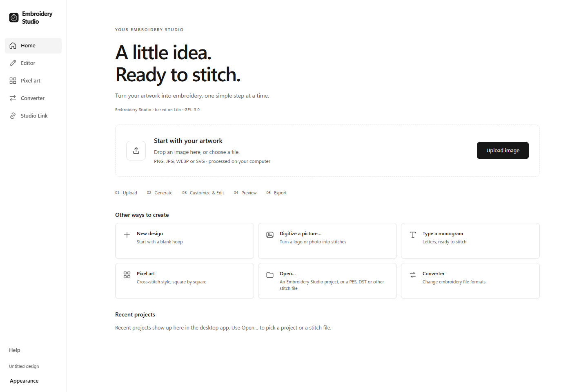
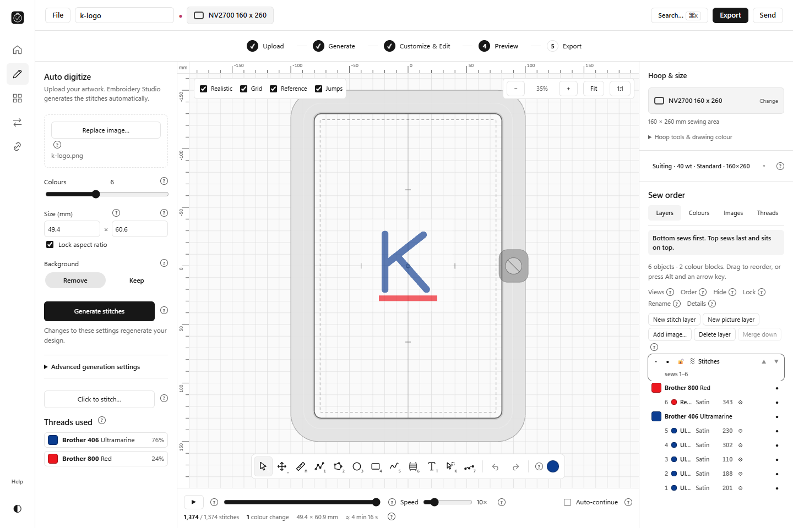
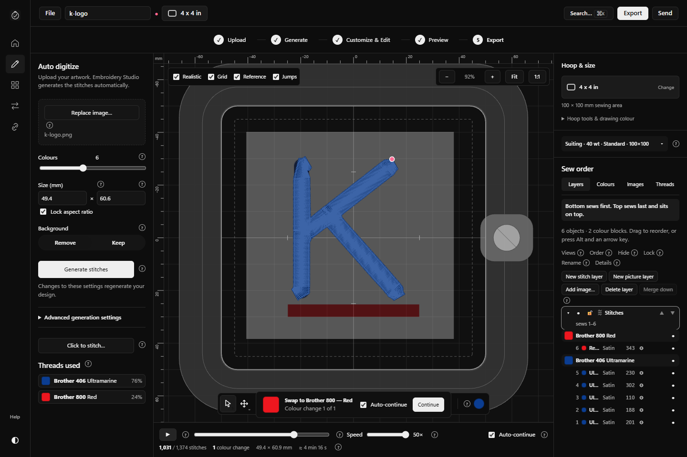

# M2 checkpoint 2 — Packages and compatibility

19 October 2026.

## Completed

- Windows release executable built as `embroidery-studio.exe`; NSIS is producing the installer with an embedded WebView2 offline installer.
- M2 source was pushed only to the user-specified **private** repository. The manual macOS universal workflow is running at [run 39304000663](https://github.com/thomastt-cryoo/embroidery-aapp-/actions/runs/39304000663).
- Replaced upstream release publishing with manual, read-only-permission private artifact builds. Disabled automatic CI runs to avoid unnecessary runner use.
- Disabled the inherited website workflow. Its initial private-repository run failed because no Cloudflare token/account was configured; logs confirm it did not deploy. This was an inherited workflow that should have been disabled before the first push. It is now disabled, including manual execution.

## Tests and results

- **60 branding, navigation, tour and update tests passed.** Direct update checks are blocked before network access.
- **32 script tests passed**, along with TypeScript, guide generation and package-isolation checks.
- **9 production acceptance checks passed** with all external HTTP(S) blocked: image conversion, selected-shape hoop changes, three layouts, simulation, all exports, project save/reopen and offline processing.
- All **13 formats** exported; all 11 readable machine formats reopened with **1,374 stitches**. PNG and G-code checked separately.
- Source comparison confirms no embroidery-engine, editing-state, project/platform implementation or M1 stylesheet changes.

## Issues and next

An initial workflow definition used a runner path in a context where GitHub disallows it. This was corrected before a macOS job started. The private macOS run will report build, native launch and browser acceptance separately. Native Windows installation and application checks are next; macOS signing/notarization and physical embroidery hardware remain explicit limits until verified.
