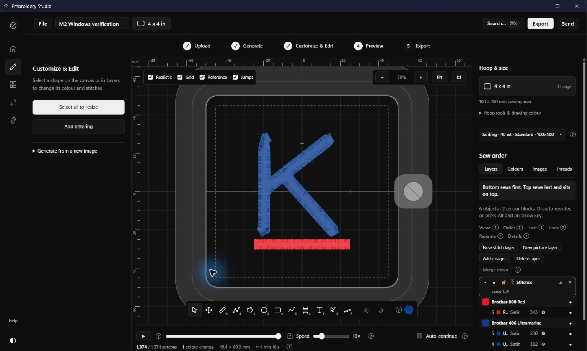
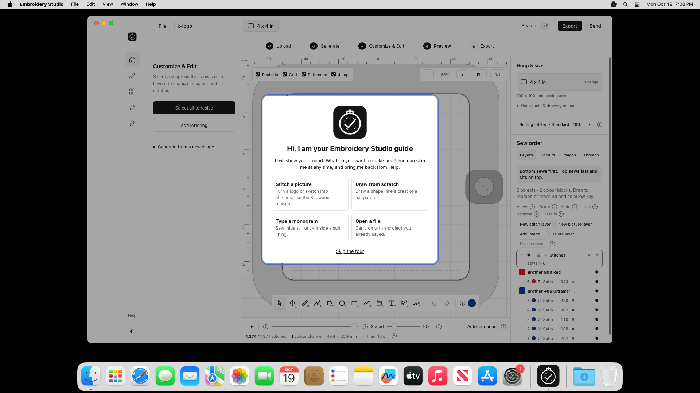

# M2 checkpoint 3 — Installed Windows and actual macOS verification

19 October 2026. Packaged application source: `6234b89c6061474bea16abe578a7b8f0f509aa2d`.

## Completed

Built the Windows NSIS installer with its offline runtime and built both the universal macOS app and DMG through the private repository. The final [macOS workflow](https://github.com/thomastt-cryoo/embroidery-aapp-/actions/runs/39307805583) passed. Downloaded artifacts match GitHub's SHA-256 digest; the extracted DMG and app ZIP match the runner's checksums. The customer delivery folder is separate from raw build archives and evidence.

Windows uses its own install location, shortcut, uninstaller, profile, project folder, protocol and Open With entries. The original Lilo executable, URL handler and all 12 existing extension defaults were preserved. Updates are disabled before network access.

## Tests and results

- **650 unique editor tests passed across the final recorded runs**: 608 unaffected tests from the full run plus all 42 tests from the two final rerun files. This is not a claim that the first full run was clean.
- **110 Windows native Rust tests passed**: 92 library tests and 18 API integration tests. A Unix-only file-URL fixture was made portable; production path behavior was unchanged.
- **96 native Rust tests passed on actual macOS**. The DMG verified, the installed native app launched, its health endpoint identified Embroidery Studio, and its sample rendered. Both Apple Silicon and Intel architectures are present; actual execution used Apple Silicon.
- **9 production workflow checks passed on each operating system** with external HTTP(S) blocked. Conversion produced 1,374 stitches. Editing, hoop selection, simulation, save/reopen, all 13 exports and 11 machine-format readbacks passed.
- The installed Windows application passed native Open/Save dialog checks, editing/undo, 100 × 100 mm hoop selection, project round-trip, PES export and simulation. The final normal-launch and installation evidence is recorded in [native results](evidence/windows-native/results.json) and [isolation results](evidence/windows-isolation.json).
- **32 script tests**, TypeScript, guide generation/check, version consistency and protected-source checks passed.

The full suite initially hit a dense-fill UI fixture timeout and a shelf-test worker startup timeout during concurrent builds. The hoop warning fixture now uses an outline with exactly the same dimensions, avoiding unrelated fill planning. The old branding assertion was updated; an engine-owned shelf-format diagnostic remains unchanged. Both affected files then passed all 42 tests without failures. No engine behavior was changed.

## Limits and runner usage

The final macOS job took **6 minutes 22 seconds**. Across the initial successful job, one cancelled job and the final job, measured macOS runner time was **18 minutes 22 seconds**, within the user's stated 200-minute ceiling. Remaining free allowance was not exposed by the available billing API; this timing is not a billing-balance claim. No paid larger runner or billing setting was enabled.

macOS native editing/file-dialog journeys, Intel execution, consumer Gatekeeper installation and physical machine sewing/Wi-Fi transfer were not fully tested. Detailed macOS workflow acceptance used Chromium on the same real runner and is clearly separated from native launch/rendering checks.

Windows is unsigned. macOS uses ad-hoc signing without Developer ID or notarization. Final branding and trusted signing/notarization remain distribution requirements. All repository activity and artifacts remain private; the inherited website workflow's failed attempt and its disabling are documented in checkpoint 2.

## Next

Review the packages and [final report](../../M2_FINAL_REPORT.md). M2 stops for approval; M3 has not begun.
