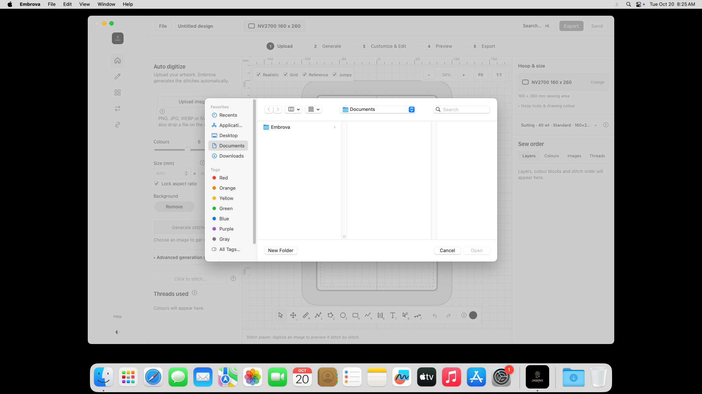
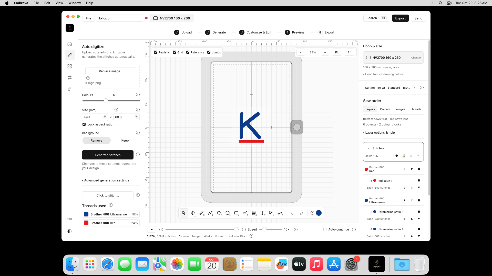
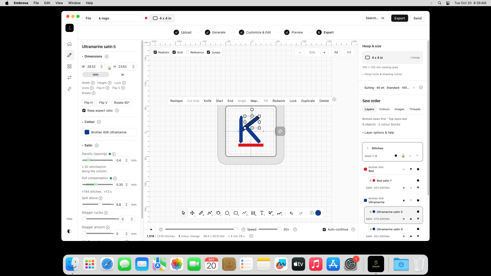
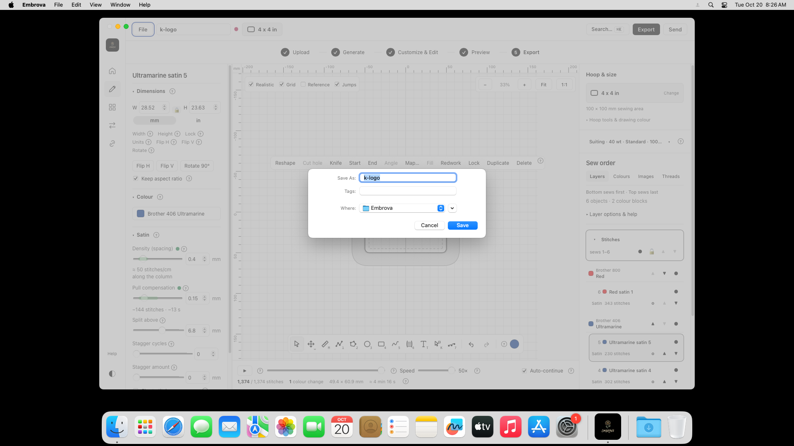

# Using Embrova on Mac

These are real, unedited screenshots of the installed Embrova app on macOS 15.7.9. The illustrated steps below were visually reviewed for personal information. This is an app walkthrough after installation. The complete ZIP-extraction, Installer authentication and consumer Gatekeeper walkthrough is still outstanding; those screens have not been invented or substituted.

## 1. Open Embrova

Open Embrova from Applications. The small flower logo and Embrova name appear together at the top left. If the introductory tour appears, you can choose Skip the tour.

## 2. Choose your picture

Click Upload image. Find your artwork, select it and click Open.

## 3. Generate your embroidery

Your picture opens in the editor. Use Generate stitches after changing the conversion settings. The example below contains 1,374 stitches; your design's count will depend on its artwork and settings.

## 4. Choose your hoop

Open Hoop & size, search for the size you need and select your hoop. The example searches for a 100 x 100 mm hoop.

## 5. Customize your design

Select a shape in Sew order to reveal its editing controls. The example changes a satin stitch setting and then restores it. Colours, thread choices and other tools remain available in the editor.

## 6. Save your editable project

Use File to save your project. Choose its name and location, then click Save. A project preserves the editable shapes so you can return to them later. Embrova uses Documents/Embrova as its default project folder.

## 7. Export your embroidery file

Click Export and choose the format used by your embroidery machine. Choose the filename and destination, then click Save. This example uses PES. Native testing confirmed that the exported file was written and had a valid PES header.

## Original screenshots and evidence

All 15 original numbered PNGs are preserved separately in `originals/`; they are 1920 x 1080 pixels. Images 004 and 005 contain CI filesystem-navigation details and are internal evidence, not customer instructions. Other originals outside this illustrated selection have not been approved here for customer use. `native-results.json` records all eight successful native checks. The original screenshot index preserves capture order.
