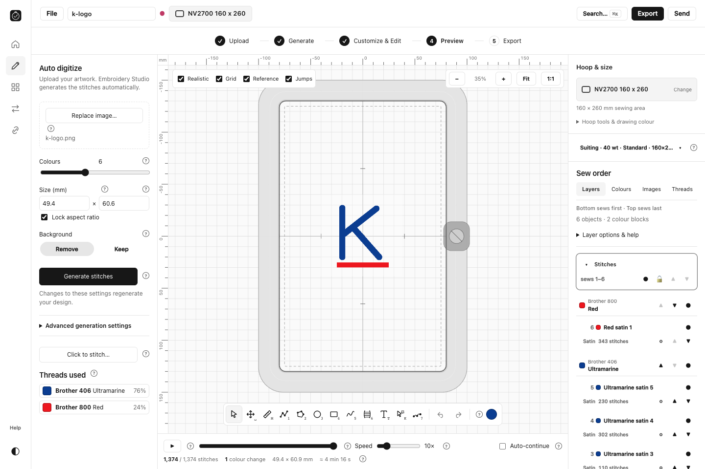

# Codemagic build 3 review — 20 October 2026

**The corrected Mac application built and installed successfully. The overall run failed because native GUI tests and screenshots were blocked by macOS permissions.** No application failure was recorded in the completed tests. Native application behavior is still unverified by this run.

Source: owner-supplied `Mac-QA-evidence (2).zip` and `Embroidery-Studio-macOS (1).zip`. Build ID `6ad6e40e7550aed810905e12`; exact source commit `bb6271b83afdc18f187e11ae0b41473a45b7d2fc`. The environment log confirms that commit. This is the Mac Stitches UI correction.

## Verified results

| Item | Result |
|---|---|
| Customer ZIP | **19,871,801 bytes**; 128,199 bytes below the strict 20,000,000-byte limit |
| Installer | 19,855,286 bytes; one complete PKG in the ZIP |
| ZIP SHA-256 | `9d5bd61cb8531d67cf5b3990b659d3713accd792e08065371340717235f3e481` |
| ZIP readback and package inspection on Windows | Passed; XAR member checksums, decoded payload, separate app identity and universal executable checked |
| Corrected UI inside delivered executable | Confirmed shared `desktop-layers` styles/code and Mac detection; old `windows-layers` marker absent |
| Mac package native extraction and code-signature validation | Passed on the runner; ad-hoc signature, not Developer ID/notarized |
| Actual ZIP installation on Mac CI | Passed; installer log says installation successful; every installed file/mode matches the built app |
| Architectures | Intel x86_64 and Apple silicon arm64 present; Intel execution not tested |
| Native Rust unit tests | **96 passed, zero failed** |
| Production browser checks on Mac | **9 passed**, zero reported problems; these are not installed-app UI tests |
| Conversion, hoops, simulation, saving/reopening | Browser checks passed: PNG to 1,374 stitches, 100×100 mm hoop, playback to completion at 50× and project round-trip |
| Exports | All 13 written; 11 readable machine formats re-read, G-code checked and PNG signature verified |
| Offline processing | Passed in the production browser with external HTTP(S) blocked; no external requests recorded |
| Runtime assets | All 458 retained, with 137 previews; lossless compression verified |

The customer ZIP is preserved at `dist/Mac-UI-Fix/Embroidery-Studio-macOS.zip`. Original supplied downloads are unchanged. Detailed source evidence is retained in `run-3/`; the independent local ZIP review is in `reports/mac-ui-fix/received-build/ZIP_REVIEW.json`.

## Exact blocker and remaining work

`run-3/evidence/mac-permissions.json` reports both `accessibilityTrusted: false` and `screenCaptureAuthorized: false`. The permission probe ran successfully, then the workflow correctly blocked the native installer walkthrough and installed-app functional tests. Neither stage was reported as passing. No native installation screenshots were captured, and clean consumer Gatekeeper testing remains incomplete.

No new full build is required for this permission blocker. The manual **Mac screenshots only - NO REBUILD** workflow is now sealed to this exact corrected ZIP and its build-3 manifest. It preserves prior test results as historical and requires all native stages to pass. An owner must connect through VNC and approve the requesting test host's Accessibility and Screen Recording permissions using normal macOS controls. The owner-started Terminal approach remains unverified until used on an actual runner; the permission gates remain strict. See `VERIFICATION_ONLY_INSTRUCTIONS.md`. Do not start a run until ready to connect; waiting consumes runner minutes.

No further Codemagic run was started during this review. No operating-system security protection or permission was changed.

## Actual Mac browser screenshot

This capture came from the production Chromium browser check on the Mac runner. It shows the corrected Sew order layout, but is **not a native application/installation screenshot** and cannot substitute for M3 consumer evidence.

