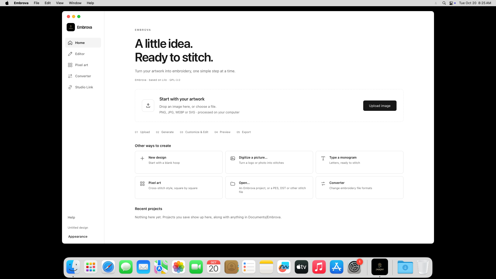
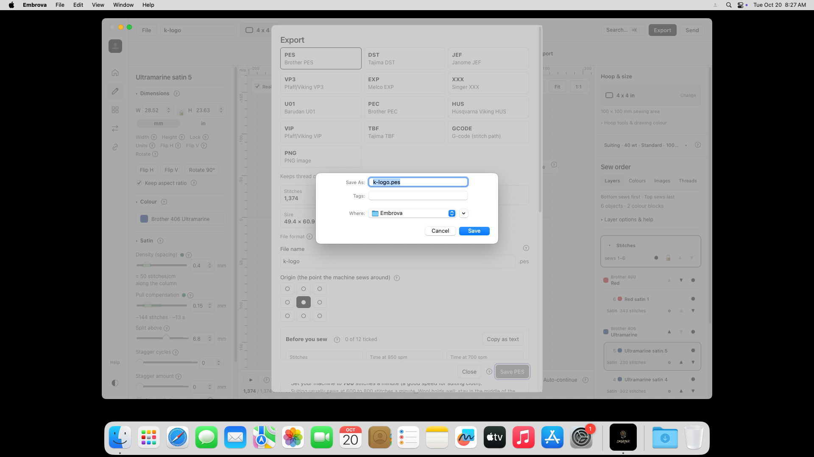

# M3 — final Embrova Mac verification and screenshot locations

20 October 2026. **The final installed Embrova app passed all eight native functional checks.** Its small rounded sidebar logo, aligned text, Embrova name and rounded native Dock icon were visually reviewed in real Mac screenshots. The owner requested that Gatekeeper/security-warning work be left aside; a complete consumer security/installer walkthrough is not claimed.

## Exact tested final package

- ZIP: dist/Embrova-Customer-Release-20261020/Embrova-macOS.zip — **20,172,883 bytes**.
- Complete installer: **20,156,946 bytes**; both Intel and Apple silicon architectures included.
- SHA-256: 94ef8b1f9798419adc96b7c1c202f99ca83ff936564136cc620fd26bac620e01.
- Compiled application source: 1a524f3c0609f8d8e647968ad4ac2cc23ed58fd9.
- Native-icon packaging workflow source: c82467e44d1d002f3512a7f48228d6823d214f02.
- Only the native Dock icon and its ad-hoc resource seal were refreshed. Executable code and embedded runtime asset bytes in both architectures were proven unchanged. No app recompilation was required.

The owner reported a successful Etsy upload of the earlier 20,207,345-byte ZIP and stopped further size tuning. The final ZIP is 34,462 bytes smaller. The original strict decimal target remains recorded as exceeded, with the owner's explicit exception; a new Etsy upload of this exact changed file was not performed by the agent.

## Actual native results

[Final GitHub run 39392239556 — successful](https://github.com/thomastt-cryoo/embroidery-aapp-/actions/runs/39392239556) used a standard Intel Mac running macOS 15.7.9. Installation read back the actual ZIP and verified every installed file/permission against the sealed build. Native signature checks covered both architectures.

| Check | Result |
|---|---|
| Image picker and PNG conversion | Pass; 1,374 stitches |
| Stitch rendering with reference hidden | Pass |
| Simulation from zero to completion at 50x | Pass |
| Hoop selection | Pass; 100 x 100 mm |
| Select satin shape and edit/restore pull compensation | Pass |
| Native project Save dialog | Pass; six editable objects |
| Native PES export Save dialog | Pass; valid 4,072-byte PES file |
| Reopen saved project | Pass; 1,374 stitches |

Execution of this final package covered Intel. ARM runtime checks on the earlier package are historical; universal signature verification is not a new ARM GUI test. Not every export format or machine was retested in this update.

## Screenshot locations

- [Current illustrated app guide](../M3/02-macOS/embrova-final-20261020/MAC_APP_WALKTHROUGH.md).
- All 15 original PNGs: reports/M3/02-macOS/embrova-final-20261020/originals.
- Original capture order: originals/screenshots-index.json.
- Visual/privacy review: screenshot-review.json.
- Compact test results: native-results.json.
- Real saved editable project/PES file: sample-files.
- Full test/package evidence: reports/embrova-branding/mac-customer-delivery/evidence.
- Earlier Embrova captures: reports/M3/02-macOS/embrova-20261020.
- Historical reports: reports/M3/archive. Historical temporary-name installation captures: reports/M3/02-macOS/github-current-20261020.

Current originals are **1920 x 1080**, unedited. Seven guide images were visually reviewed for private owner paths and account information. Path-entry images 004 and 005 are internal CI evidence and excluded from the customer guide. Other originals outside that illustrated selection have not been approved for customer use.

## Agreed testing scope

Ordinary CI installation and installed-app use passed. Every ZIP-extraction/Installer screen transition, customer authentication and consumer security warning is not fully documented for this final build. Older partial captures are not presented as screenshots of the new branding. Further security-warning testing was explicitly deferred by the owner.

No security settings were disabled or warnings fabricated. Windows remains unsigned and Mac remains ad-hoc signed without Developer ID/notarization. The requested branding/package update is finished; no additional milestone is being started.
