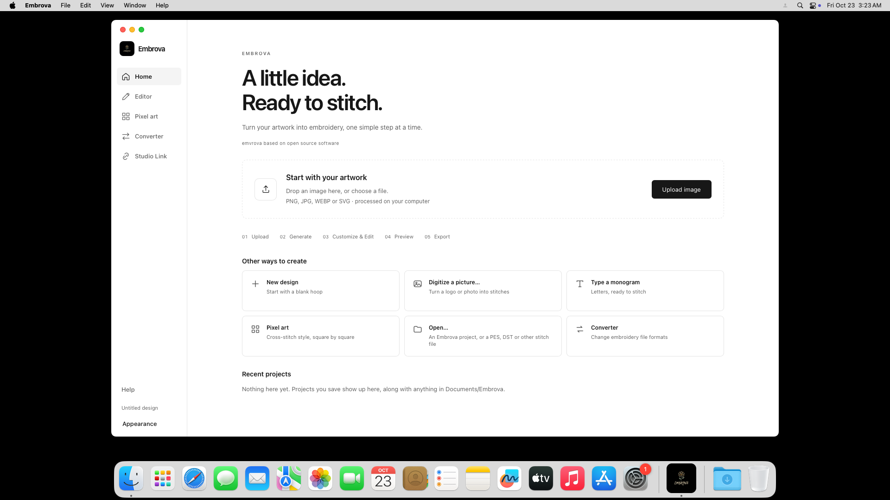
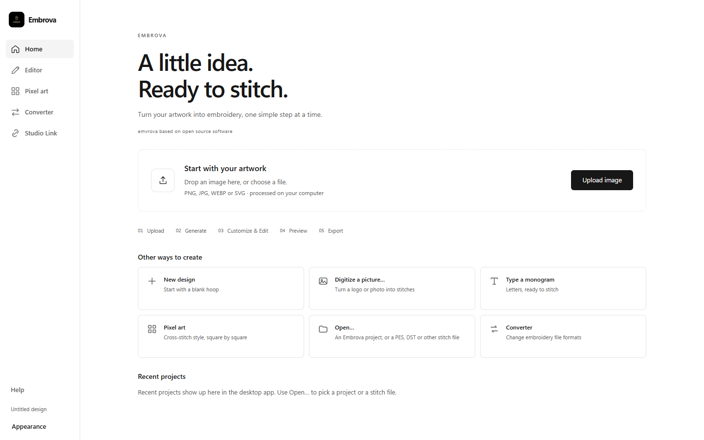

# Plain home-credit update — 23 October 2026

Both rebuilt customer packages show exactly **emvrova based on open source software** as plain text. The original home-credit button, URL and click action are removed. The owner's exact requested spelling is preserved. The app's product name remains Embrova.

| Platform | ZIP bytes | Download |
|---|---:|---|
| Windows | 17,042,643 | [Embrova-Windows.zip](../../dist/Embrova-Customer-Release-20261023/Embrova-Windows.zip) |
| macOS | 20,146,115 | [Embrova-macOS.zip](../../dist/Embrova-Customer-Release-20261023/Embrova-macOS.zip) |

## Verification

- 27 existing UI checks passed, including plain credit and no browser-opening action.
- Production browser rendering passed with Windows and Mac platform layouts; clicking the credit opens nothing. These browser screenshots are not native installation evidence.
- [Windows CI run](https://github.com/thomastt-cryoo/embroidery-aapp-/actions/runs/39893460690) installed and launched the exact delivered ZIP and verified the installed executable checksum.
- [Mac CI run](https://github.com/thomastt-cryoo/embroidery-aapp-/actions/runs/39892683483) built the universal Intel/Apple silicon package, verified all-architecture signatures, installed it and passed project compatibility checks.
- Nine native Intel Mac checks passed: exact noninteractive footer, PNG conversion (1,374 stitches), canvas, simulation, 100 × 100 mm hoop, stitch settings, save, reopen and PES export (4,072 bytes).
- Rounded native icon resources are preserved. All 459 runtime assets remain included. The embroidery engine and M1 layout are unchanged.
- Both final ZIPs pass CRC and exact-checksum verification and contain one installer plus START HERE, LICENSE and NOTICE. Full licensing text is preserved, with platform newline conventions accounted for.

The Mac ZIP remains above the original 20,000,000-byte target under the owner's previously approved size exception. At 20,146,115 bytes it is smaller than the earlier 20,207,345-byte package the owner confirmed Etsy accepted. No additional compression tuning or asset removal was performed.

## Screenshots

Actual installed Mac app:

Production Windows-layout browser rendering:

## Scope

Only the shared Home credit and the checks/build configuration required to deliver it changed. The original Lilo repository and installation were not modified. The owner's installed desktop applications were not opened or reinstalled. Both builds used the existing separate Embrova identity. Signing status is unchanged; consumer security-warning testing remains deferred as requested. Current native GUI execution covers Intel; the universal ARM slice is bundled and signature-verified, not separately GUI-tested for this text-only update.

Source commit: `1a37e1986c3ea5423432aa080963315b0b32a775`. Exact delivery checksums are recorded in FINAL_DELIVERY.json and in the delivery folder's SHA256SUMS.txt.
