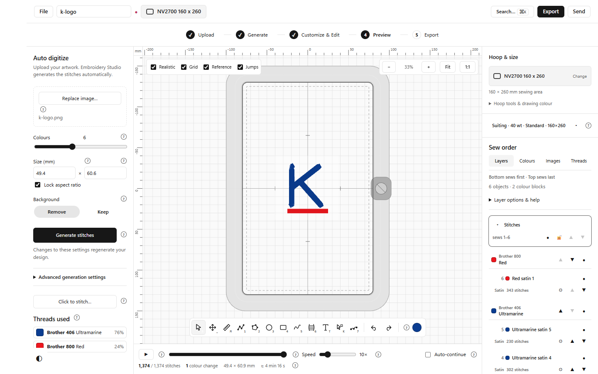
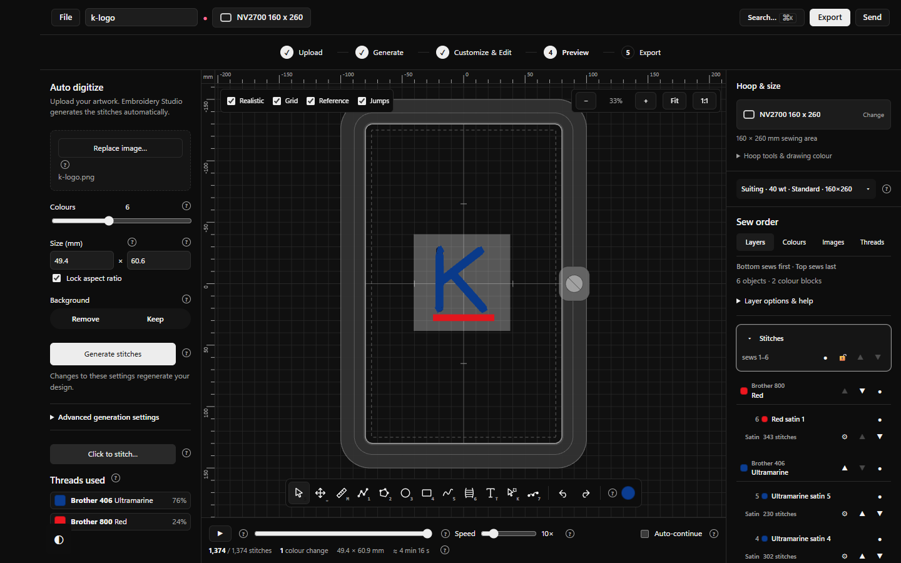

# Mac Stitches panel fix — 20 October 2026

The Windows Sew order fix now applies to macOS as well. Shape names have a separate line from stitch counts and actions. Advanced layer controls and help start collapsed. Clicking the active Stitches heading, or pressing Enter on its focused row, expands or collapses its contents. Selecting a different layer still selects it; visibility and lock buttons act independently. All existing editing tools remain available.

The existing Windows CSS declarations were retained exactly under a shared desktop class. The stylesheet is now named `editor/src/sew-order.css`. The embroidery engine, stitch algorithms, state management, project format, export implementation, app identity and security configuration were not changed. The original Lilo installation and upstream repository were not modified.

## Verification

| Check | Result |
|---|---|
| Layer, sequencer and reordering unit tests | 43 passed in 3 files, including Mac heading/keyboard interaction and independent lock controls |
| Mac browser interaction/layout checks | 12 passed: PNG conversion to 1,374 stitches, heading/disclosure clicks, Command-Z undo, shape/colour/layer order, visibility, locking, details and advanced controls |
| Windows browser regression | Same 12 checks passed; no Windows installation or screen control performed |
| Readable layouts | Passed at 960×600, 1280×800 and 1440×900; shape-name widths 123–157 pixels; no horizontal overflow |
| Light and dark modes | Captured and reviewed in browser |
| TypeScript checks and production frontend build | Passed |
| Runtime preservation | All 458 runtime assets retained, including 137 previews; lossless compression and protected source checks passed |

Evidence: `validation.json`, `browser-ui-results.json`, `windows-regression/browser-ui-results.json` and `asset-preservation.json` in this folder. Build warnings concerned existing engine dependencies, dynamic imports and large chunks; the build completed successfully.

## Browser screenshots

These are real captures of the running frontend in Chromium on Windows with a Mac user agent and Mac keyboard behavior. They are **not native macOS, Safari/WKWebView or customer installation screenshots**.

Narrow-window captures: `mac-960-light.png` and `mac-1280-light.png`. Windows regression captures are in `windows-regression/`.

## Deliverable and remaining Mac step

The fix is in source; it does not alter the already downloaded Mac ZIP. No Codemagic run was started and no Mac runner minutes were used for this change. A new universal Mac application/ZIP must be built from updated `main` before customers receive this fix.

For that build, choose the existing **Embroidery Studio — Mac build, native tests and M3 screenshots** workflow. The **Mac screenshots only - NO REBUILD** workflow uses the older sealed ZIP and cannot include this change. The build retains the strict 20,000,000-byte ZIP gate; a new exact package size is not yet available. Its native screenshot tests still require the owner's macOS permissions; the previously documented permission blocker is not resolved by this UI change. Clean consumer Gatekeeper testing remains outstanding.
