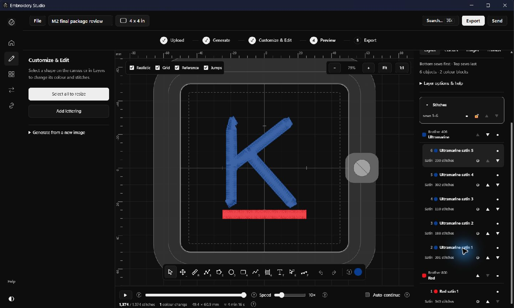
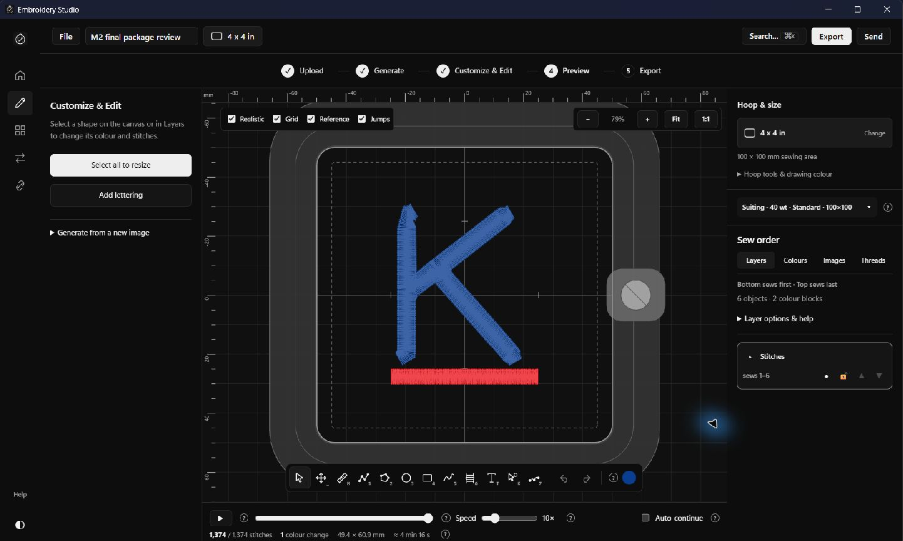
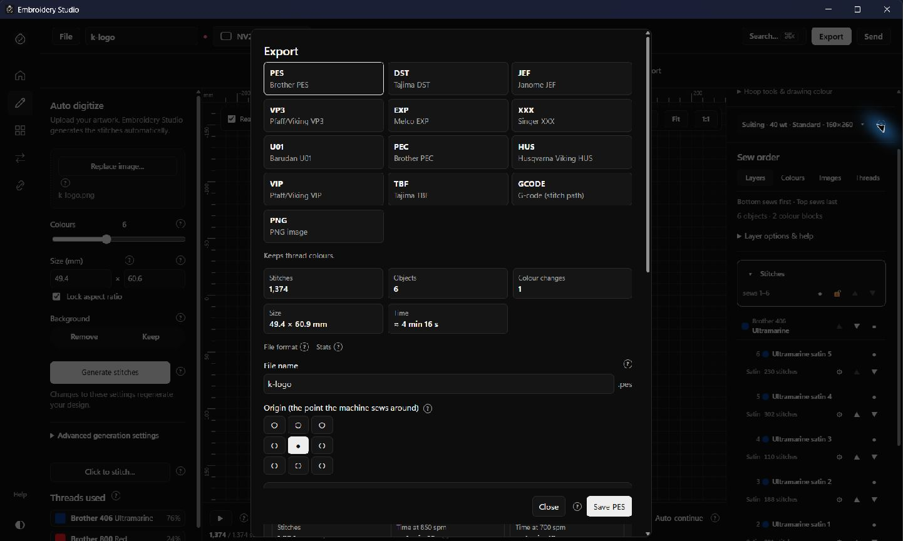
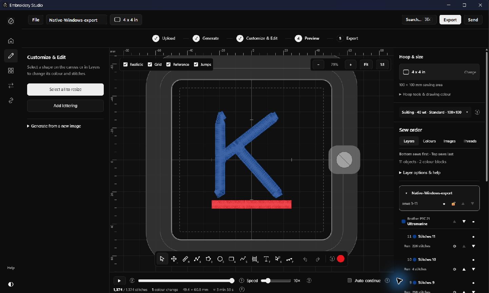

# Windows UI correction completed — 20 October 2026

The crowded Sew order panel is fixed in the installed Windows application. Clicking the active **Stitches** heading now expands or collapses the layer. Names have a separate line, available reorder buttons remain visible, and advanced layer controls/help are under **Layer options & help**. No embroidery engine or state-management algorithms were changed.

## Corrected Windows download

`dist/Windows-UI-Fix/Embroidery-Studio-Windows.zip`

| Item | Verified result |
|---|---|
| ZIP size | **16,967,117 bytes** — below 20,000,000 bytes |
| Installer size | **16,960,575 bytes** |
| ZIP SHA-256 | `7e746e3b6c1dfafd73d7ba2e7934826355984dcd5d31470319ab950851f954e3` |
| Installer SHA-256 | `828f323fa230bd84a7a0cf593f85ae66198236bf5a413d69f5bec775a1ce14d5` |
| ZIP contents | One installer, start instructions, licence and attribution |
| ZIP integrity/readback | Passed; extracted installer matches build |
| Installation | Passed, exit code 0; updated the existing separate Embroidery Studio installation from the actual ZIP contents |
| Original Lilo | Unchanged; executable hash and file defaults checked |
| Offline assets | All 458 runtime assets retained; only the standard Microsoft WebView2 bootstrapper may download its runtime when missing |

The approved M2 Windows and macOS ZIPs were preserved at their original locations. Use the corrected Windows ZIP linked above for this fix. No macOS build, installation, runner or UI test was performed in this work.

## Tests and results

| Test | Result |
|---|---|
| Installed Windows app launch | Passed |
| Top Stitches heading click | Passed; collapses the layer |
| Disclosure button | Passed; expands it again |
| Native shape move and undo | Passed; Red satin moved from sew position 6 to 5 and back |
| Native stitch details | Passed; Red satin shows 343 stitches after undo |
| Native PNG import/conversion | Passed; real Windows file picker, 1,374 stitches generated |
| Native PES export | Passed; 4,072-byte file with `#PES0001` signature |
| Native PES reopen | Passed; renders the design with 1,374 stitches |
| Native project Save As/reopen | Passed; saved `.lilo` opens cleanly with 1,374 stitches |
| Recovered user project | Passed; reopened cleanly with 1,374 stitches |
| Sew order automated tests | **44 passed** |
| Browser interaction checks | **12 passed**, including layer/block/shape reorder, undo, visibility, locking and details |
| Production frontend regression | Passed: conversion, hoop selection, simulation, 13 exports and project save/reopen |
| Offline processing | Production frontend regression passed with external HTTP(S) blocked |
| Narrow layouts/light/dark | Passed at 960×600, 1280×800 and 1440×900; no horizontal overflow |
| TypeScript and source-preservation checks | Passed |

The initial parallel unit run hit the existing 20-second engine-initialization timeout in three first tests. Running sequentially passed all 44 tests without relaxing timeouts. Native UI snapshots sometimes needed a second observation after asynchronous conversion/reordering; the settled results above were verified. A debug-attachment launch was blocked by automatic execution policy; native verification used normal Windows UI controls instead.

Native installation testing was an **update/reinstall on this Windows PC**, not a clean virtual-machine test. All 13 formats were exercised in the production frontend; the installed Windows executable additionally wrote and reopened PES. Physical stitching on an embroidery machine was not tested. This review installer remains unsigned. Disabled single-layer arrows are intentional: another layer is required before layer order can change. Shape and colour-block arrows change order within the layer. Long names may still ellipsize in narrow panels, with their complete names in tooltips; the list scrolls vertically.

## Actual installed-app screenshots

These are actual Windows application captures. Browser screenshots are separately named `windows-960-light.png`, `windows-1280-light.png`, `windows-1440-light.png` and `windows-1440-dark.png`.

## Evidence locations

All paths below are relative to `reports/windows-ui-fix/`:

- `package.json`, `installation.json`, `windows-isolation.json`: exact package identity, installation result and original-Lilo preservation.
- `windows-build.txt`, `asset-preservation.json`: successful Tauri/NSIS build and asset-preservation evidence.
- `native-ui-results.json`, `native-export-check.json`, `Native-Windows-export.pes`, `Native-Windows-project.lilo`: native test evidence.
- `unit-tests.txt`, `typecheck.txt`, `preservation-check.txt`, `browser-ui-results.json`: automated checks.
- `production-regression/results.json`, `production-regression/exports/`: production regression results, all 13 exported formats and saved project.
- `Recovered-open-design.lilo`: separate recovery copy saved before restarting. The previous project file was not overwritten.

Implementation commit: `3a9124331e007d3b33fec8fb274cd5822e619ef3`. No public release or upstream repository changes were made. The fix is installed locally; this report and ZIP complete the requested Windows correction.
